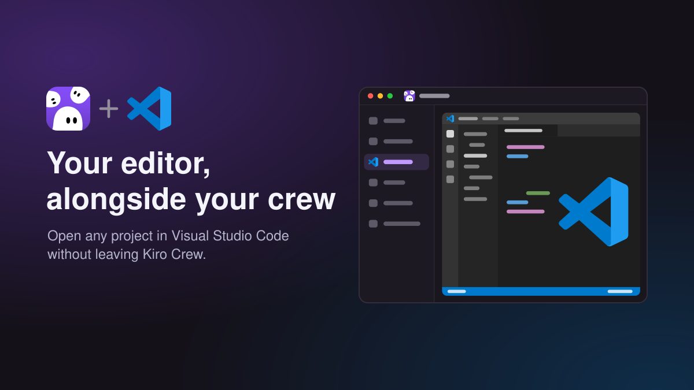

# Visual Studio Code Server Integration for Kiro Crew

A Kiro Crew app that runs the official Visual Studio Code server on your machine and shows a full Visual Studio Code in a Kiro Crew page, with terminals, debugging, the Microsoft Marketplace and your extensions. A small companion extension connects that VS Code back to Kiro Crew, so Kiro Crew can open a file at a line in VS Code and see which file VS Code has open. VS Code's own Chat can run Kiro Crew sessions, and VS Code gets a Kiro Crew tab in its right-hand pane.

The app is named `vscode-pane` and appears in the sidebar as **Code**.

## Requirements

- The Kiro Crew desktop app, version 0.13.0 or later.
- Node.js on your PATH. The app's backend is a Node program.
- Internet access on first start. The app downloads the matching VS Code server build (about 245 MB) unless it finds one already.
- Windows, macOS or Linux.

## Install

From the app registry (recommended):

1. In Kiro Crew open Apps, then the Sources menu, and add this repository as a source: `https://github.com/chapmanjw/kiro-crew-vscode-app` (branch `main`). The repository's `app-registry.json` lists the app.
2. Find "Visual Studio Code Server Integration" in the App Store and install it.
3. Enable the app and approve the trust prompt. When asked, approve the API permissions it lists. Kiro Crew keeps the app's token away from them until you do.
4. Open **Code** in the sidebar.

From a local clone instead:

1. `git clone https://github.com/chapmanjw/kiro-crew-vscode-app` and `cd` into it.
2. In Apps, open the Sources menu, choose install from a local path and give the absolute path of the clone.
3. Enable the app and approve the trust and permission prompts as above.

After a source change on a local install, use Update on the app in the App Store. Disable and enable alone reuses the installed copy.

## Use

- **Code** in the sidebar opens VS Code in tabs, one VS Code window per tab. New opens another.
- The **Open in Code** button in a chat's footer opens that chat's project folder in a tab.
- **Open in VS Code** in a file or folder menu opens that path in VS Code.
- In VS Code, the **Kiro Crew** tab in the right pane shows the Kiro Crew dashboard. The first time, it signs in by itself when Kiro Crew has a dashboard URL. If the page says there is none, run the command it shows (`kirocrew config set dashboard.url <origin>`), restart Kiro Crew, and the tab signs in on its own from then on. You can also paste a sign-in link into the tab.
- In VS Code's Chat, choose the **Kiro Crew** session type to chat with a Kiro Crew session, with tool cards and approvals.

## Notices

- **VS Code Server licence.** The server the app downloads is Microsoft's Visual Studio Code Server, under the [Visual Studio Code Server License Terms](https://aka.ms/vscode-server-license). The launcher passes `--accept-server-license-terms` for you, so by installing and using the app you accept those terms. The server is for your own use on your own machine, so do not redistribute builds.
- **Trademarks.** The Visual Studio Code name and icon are trademarks of Microsoft Corporation. This project is independent and is not affiliated with or endorsed by Microsoft. The Kiro Crew ghost mark belongs to Kiro Crew.
- **Full owner access.** The Kiro Crew tab in VS Code is a full owner session of your Kiro Crew dashboard. Anything you can do in the dashboard you can do from that tab, including approving tool calls. That is the feature. The session is kept in an owner-only file under the app's data folder, and any process running as you can read it. Kiro Crew still refuses the local-only actions (revealing secrets, writing config, the host file picker) to this session.

## More

- [Architecture and API](docs/architecture.md): how the app, launcher and server fit together, the HTTP API, and restarts and failures.
- [Features in detail](docs/features.md): tabs, VS Code Chat, theming, the dashboard page, the Kiro Crew tab and its security model, secret storage.
- [Configuration and server updates](docs/configuration.md)
- [Development, tests and icons](docs/development.md)
- [Using the app on a Remote Crew](docs/remote-crew.md)
- [Known limits](docs/known-limits.md)

## Licence

MIT, see [LICENSE](LICENSE). The licence covers this repository's code, not the downloaded VS Code server or the marks above. See [NOTICE](NOTICE) for the Kiro Crew artwork and the VS Code mark.
